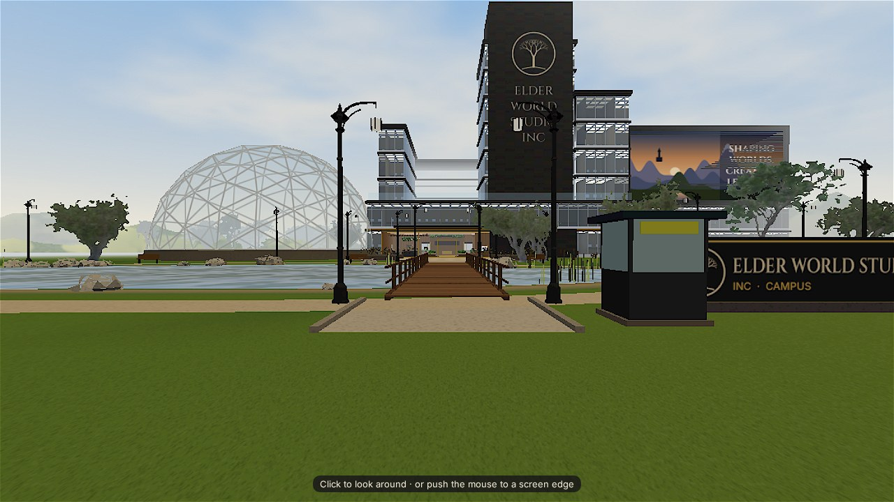
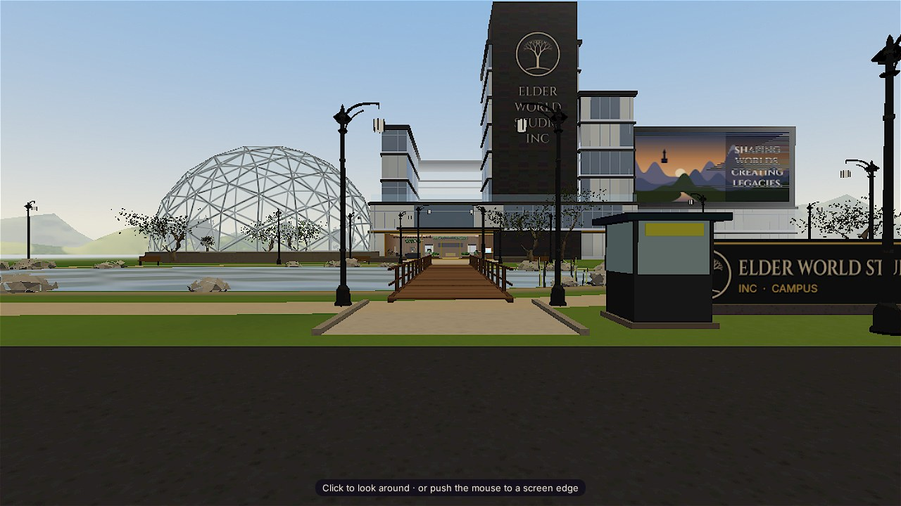
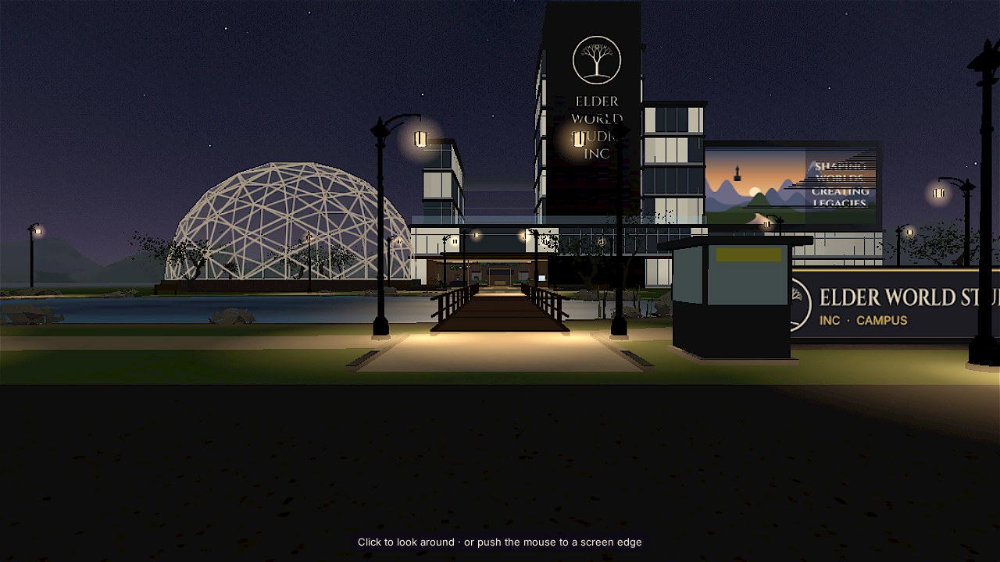
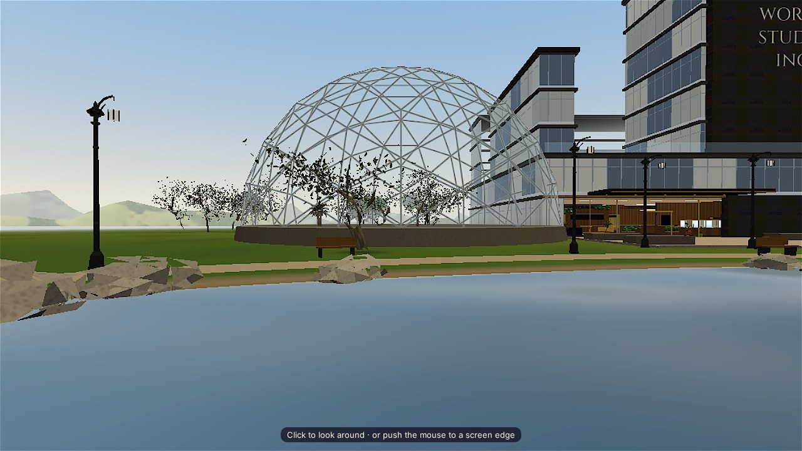

# Nerthus dome rendering fix

**Result:** Local visual checks show a clearer glass shell, legible ribs in day and night views, and five colored 3D plants inside the dome.

The dome shader now uses a lighter blue glass tint with lower reflection and opacity. Its triangulated frame is darker by day and warm graphite at night. Interior tree leaves use a stronger green instance tint. No geometry was added for this fix.

## Visual evidence

All shots use the local branch at the front road viewpoint, except the closer daytime view. The before shot is from the carried-over build before this fix.

| View | Evidence |
|---|---|
| Before, road by day |  |
| After, road by day |  |
| After, road by night |  |
| After, closer daytime view |  |

## Checks

- Browser-loaded local app at `?xtier=0`, daytime and nighttime. No page errors; `domeTrees3d` reported 5. The closer screenshot also reported 5.
- Responsive smoke check: 390×844 and 1440×900 both had document/body widths equal to viewport widths; no page errors.
- `git diff --check`: passed.
- Linkinator: passed, 6 links scanned.
- Lighthouse: accessibility 100; performance 49. Its report showed 3.68 s total blocking time and unminified/unused JavaScript opportunities. This score is from the local container browser and does not verify the 45 FPS hardware target.
- Local headless frame sample: 1 FPS at 1280×720. The required 45+ FPS on pve-mini-3070 is unverified; run the pipeline hardware QA before promotion.
- No `package.json` or repository build/test scripts are present. No staging gate or deployment was run.
