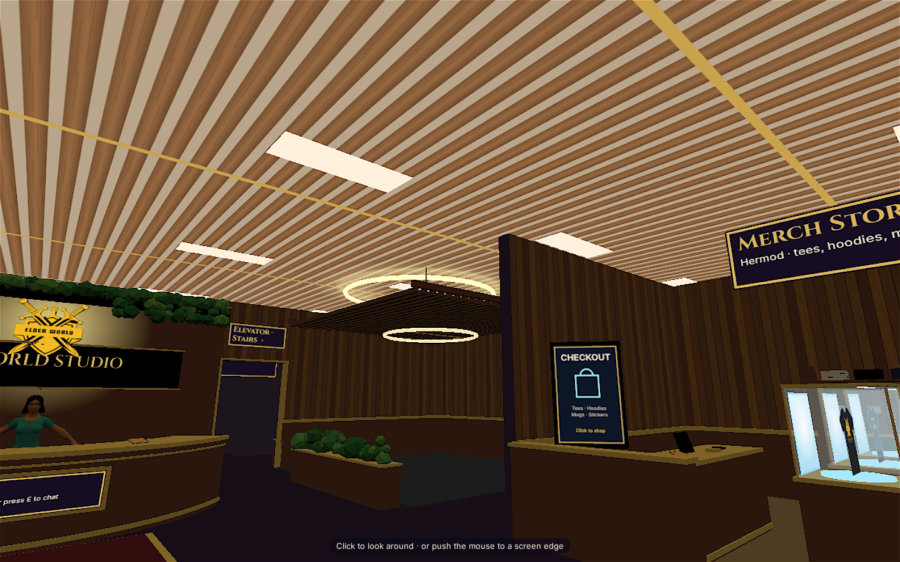

# P0 Sunna ceiling audit — lod0_lt_7

## Result

Hardened the shared indoor ceilings so they use opaque surfaces that test and write depth on both sides. The ground-floor wood-slat canvas now uses an opaque 2D context; upper-floor ceilings explicitly use the same depth and sidedness settings. Existing colors, slat pattern, brass trim, and warm fixtures are unchanged.

The supplied `lod0_lt_7` target is not present in this checkout. The world reserve creates lot pads procedurally; Lot 7 has no custom building or interior ceiling here. I inspected the shared lobby ceiling as the available indoor ceiling source. In the night render, stars were not visible through it before or after the change, so the fix is a rendering safeguard and not a reproduced leak. A reviewer with the specific target asset should confirm that asset too.

## Visual evidence

Captured at 1440×900, `?time=00:00&xtier=0`, same camera position and look direction. Day/night reported `night` (sun elevation −62.5°); after render used tier 0 at 0.85 pixel ratio, buffer 1224×765. The warm wood slats, taupe backing, brass lines, and recessed fixtures remain visible; no stars appear through the ceiling.

| Before | After |
|---|---|
|  |  |

## Verification

- Browser loaded the office scene; zero JavaScript page errors.
- Night state and camera landmarks were read from `window.__ewsOffice` after load.
- Before/after screenshots show the same view and unchanged stylized-realistic material and warm lighting, with no stars visible through the ceiling.
- `node --input-type=module --check` passed for `engine.js` and `floors.js`; `git diff --check` passed.
- Linkinator scanned 6 links from `/office/index.html` and passed.
- Lighthouse: accessibility 100; performance 50 (below the 80 target) on this local software-rendered preview. This is not a 45+ FPS measurement on the requested pve-mini-3070 tier.
- Placeholder scan found no placeholder text; its only match was the code querying DOM elements with a `placeholder` attribute.
- No `package.json`, build script, or repository test command is present. The local static server returns 404 for `/api/office/state` and `/api/office/world`; the browser had zero JavaScript page errors, and the world websocket is unavailable in this preview.
