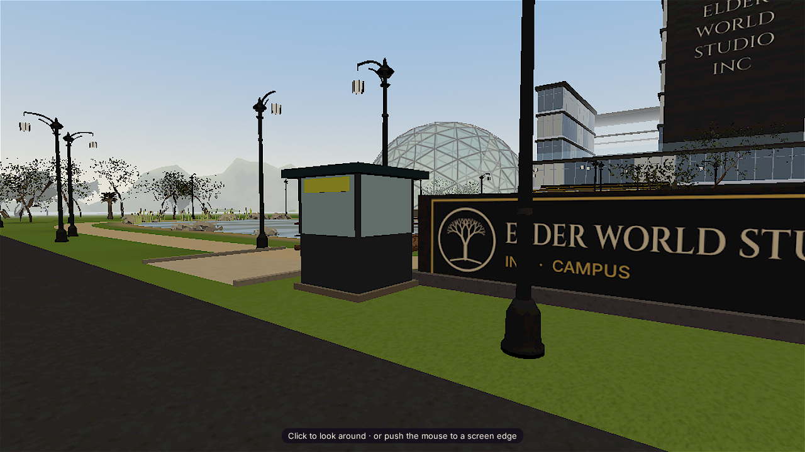
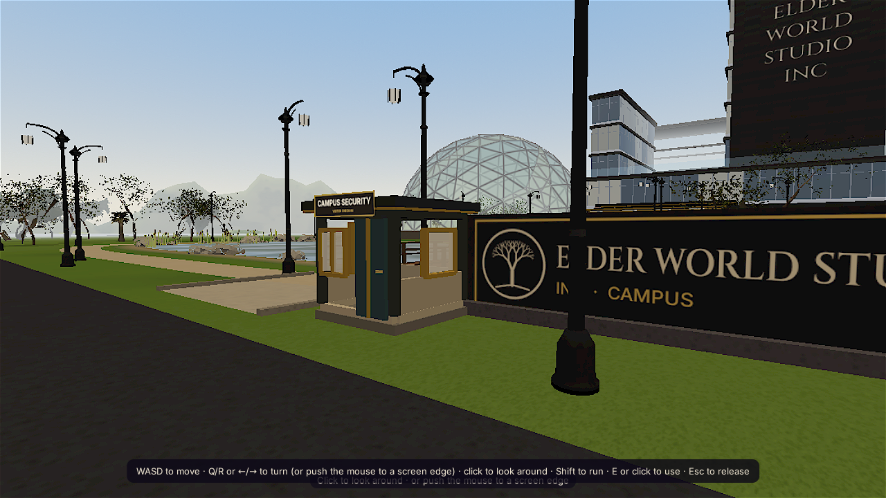

# Nerthus campus guard booth — fix evidence

**Task:** `20261018-014032-office-nerthus-world-exterior-playte-1-fix`  
**Status:** Prepared for office QA; final acceptance is pending.

## Change

Replaced the plain gate block with a compact guard booth: stone plinth, framed shell, front and side glazing, a full-height entry door with handle, overhanging roof, and a two-line `CAMPUS SECURITY / VISITOR CHECK-IN` sign. The booth remains at the existing campus entrance position. Its visible glazing, shell, and sign use three meshes; the sign texture and mesh are released on module disposal.

## Before and after

Both captures use the local 3D scene, the gate camera (`10,70,4.6,63`), and a 1280×720 viewport.

| Before | After |
| --- | --- |
|  |  |

The post-change scene query found the shell/roof/door frame, window glazing, and sign at the gate coordinates. The renderer’s visible draw breakdown listed one draw for each of those three meshes.

## Verification

- `node --check site/office/modules/world-live/index.js` — passed.
- `git diff --check` — passed.
- Served `site/` locally at port 4174 and inspected the gate camera in Chromium using SwiftShader. The after capture visibly shows windows, a door, roof, and legible signage.
- Local full-scene snapshot after the change: **125 draw calls, 270,492 triangles**. The scene is dynamic, and the local renderer is SwiftShader; these totals are not a controlled before/after performance comparison or a pve-mini-3070 result.

## Pending acceptance

No office QA team confirmation or pve-mini-3070 hardware run is available in this local fix stage. The required **45+ FPS** result must be recorded by the office QA pipeline on that device before acceptance. No deployment was performed.
